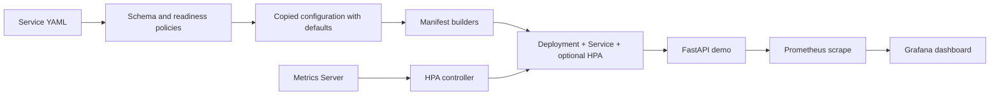

# LaunchPad

LaunchPad is a student-built internal developer platform prototype. A developer describes a service in YAML; Python checks it and generates a Kubernetes Deployment, Service, and optional HorizontalPodAutoscaler (HPA). It demonstrates repeatable configuration and useful guardrails without adding a portal or a large platform framework.

The project includes a FastAPI demo, Prometheus metrics, a Grafana dashboard, CI, and an undeployed Terraform AWS architecture. A readiness score is a local policy assessment: **it does not establish production readiness**.



Prometheus supplies dashboards; Kubernetes Metrics Server supplies HPA CPU metrics. They are separate paths. CI exercises configuration generation; it does not deploy to Kubernetes or AWS.

## Stack and repository

Python 3.11, FastAPI, Uvicorn, PyYAML, pytest, prometheus-client, Docker, Kubernetes/Minikube, Prometheus 3.10.0, Grafana 13.2.1, Terraform >=1.5 and the AWS provider.

| Path | Purpose |
| --- | --- |
| `app/main.py` | Demo endpoints and bounded HTTP metrics |
| `platform/preflight.py` | Schema, resource checks, readiness score and CLI |
| `platform/generator.py` | Defaults, manifest builders, atomic output and CLI |
| `platform/benchmark.py` | In-memory configuration line measurement |
| `platform/examples/service.yaml` | Local demo input; mutable image intentionally allowed |
| `tests/` | Unit and CLI regression tests |
| `tests/fixtures/policy-ready.yaml` | Synthetic digest fixture; never deploy it |
| `kubernetes/` | Older hand-written fixed-replica reference, not generator output |
| `observability/` | Local monitoring Compose, scrape config and original dashboard |
| `infrastructure/terraform/` | VPC, subnets, routing, security group and IAM role definitions |
| `.github/workflows/ci.yml` | Tests, policy checks, benchmark, image build and Terraform validation |
| `docs/` | Verification record and guided explanation |

Keep the directory named `platform` without `platform/__init__.py`. Scripts load sibling files by path so Python's standard-library `platform` remains available. Invoke scripts by path rather than `python -m platform.generator`.

## Local setup

Install Python 3.11 and Git. Docker Desktop with Compose is needed for image/monitoring checks. Minikube, kubectl and Terraform are optional for their respective workflows. No AWS account is needed.

```bash
python3.11 -m venv .venv
source .venv/bin/activate
python -m pip install -r requirements.txt
python -m pytest -q
python -m uvicorn app.main:app --host 127.0.0.1 --port 8000
```

In another terminal, `curl http://127.0.0.1:8000/health` returns `{"status":"healthy"}`. `/` identifies the demo, and `/metrics` exposes Prometheus counters and latency histograms. Use one Uvicorn worker: multiprocess metric aggregation is not configured. `/health` is a basic process check, not a dependency check.

Direct Python dependencies are pinned. Transitive dependencies, the Python base image and platform-specific wheels are not fully locked; builds are repeatable workflows, not byte-identical artifacts. Review dependency updates and vulnerabilities separately.

## Service specification

```yaml
name: payments-api
image: payments-api:local
port: 8000
replicas: 2
health_path: /health
resources:
  cpu: 100m
  memory: 64Mi
  cpu_limit: 500m
  memory_limit: 256Mi
autoscaling:
  enabled: true
  min_replicas: 2
  max_replicas: 5
  target_cpu: 70
```

| Field | Validation/default |
| --- | --- |
| `name` | Required, lowercase letter first, letters/digits/hyphens, 1–63 characters, alphanumeric last |
| `image` | Required nonempty string without whitespace; no registry lookup or full image grammar validation |
| `port` | Required integer 1–65535; booleans excluded |
| `replicas` | Integer 1–1000, default 1; ignored in the Deployment when HPA is enabled |
| `health_path` | Starts with `/`, no whitespace; default `/health` |
| `resources.cpu` | Request; defaults to `100m` |
| `resources.memory` | Request; defaults to `128Mi` |
| `resources.cpu_limit`, `memory_limit` | Optional limits, each defaults to its request |
| `autoscaling.enabled` | Boolean, default false |
| `autoscaling.min_replicas` | Integer 1–1000, default 1 |
| `autoscaling.max_replicas` | Integer 1–1000, default 3; must be >= minimum |
| `autoscaling.target_cpu` | Integer percentage 1–100, default 70 |

Resources and autoscaling must be mappings if supplied. Partial mappings receive missing defaults in a deep copy. CPU quantities support decimal cores or `m`; memory supports bare bytes, decimal `k/M/G/T/P/E`, and binary `Ki/Mi/Gi/Ti/Pi/Ei`. Values must be positive. This deliberately supports a subset of Kubernetes quantity syntax. Limits cannot be below requests, including default requests. Legacy specifications keep matching requests and limits.

Unknown keys are currently ignored; typo detection, duplicate YAML key rejection and complete Kubernetes schema validation are outside this checker. Disabled autoscaling settings are still validated if provided. Kubernetes admission validation remains necessary.

## Preflight and readiness

```bash
python platform/preflight.py platform/examples/service.yaml
python platform/preflight.py tests/fixtures/policy-ready.yaml --strict
```

Schema errors produce actionable `FAIL` findings, status `INVALID`, no score and exit 1. Valid input produces six `PASS`/`WARN` findings:

| Explicit policy | Points |
| --- | ---: |
| Health path configured | 15 |
| CPU request configured | 15 |
| Memory request configured | 15 |
| Availability floor >=2 | 20 |
| CPU autoscaling enabled | 15 |
| Image pinned using SHA-256 digest syntax | 20 |

Availability uses HPA minimum when enabled, otherwise fixed replicas. Scores describe the **original input before defaults**. All policies passing gives `READY` (100); otherwise `NEEDS_ATTENTION`. Normal mode allows warnings (exit 0); `--strict` rejects warnings (exit 1). Usage errors exit 2. Unreadable or malformed YAML exits 1.

Digest syntax does not prove an image exists, is trusted, is scanned, or is deployable. The strict fixture contains a synthetic digest at `example.invalid`; it tests policy behavior only. A fixed-replica service may be entirely suitable locally despite losing autoscaling points. Limits, probes actually succeeding, capacity, authentication and resilience are not established by the score.

## Manifest generation

```bash
python platform/generator.py platform/examples/service.yaml
python platform/generator.py platform/examples/service.yaml -o /tmp/launchpad-demo.yaml
python platform/generator.py tests/fixtures/policy-ready.yaml --strict -o /tmp/policy-test.yaml
```

The default output is `platform/generated.yaml` relative to your working directory. Builders emit Deployment, ClusterIP Service (port 80 to your target port), then optional HPA. Readiness and liveness use the configured HTTP endpoint. Output parents are created after validation; serialization and a complete temporary write precede atomic replacement. Invalid schema, strict warnings and failed replacement preserve an existing output. Filesystem durability across power loss is not promised. The CLI rejects using the input file as the output path.

Rolling updates declare `maxUnavailable: 0` and `maxSurge: 1`. This needs spare capacity and working readiness checks; it is **not a zero-downtime guarantee**. HPA deployments omit fixed replicas so repeated generation does not declare a competing count. Removing replicas from a previously applied fixed-replica manifest can cause a one-time reset; inspect field ownership and test that migration separately. See the [Kubernetes HPA migration guidance](https://kubernetes.io/docs/tasks/run-application/horizontal-pod-autoscale/) for replica-field transitions. The generator does not automatically remove an existing HPA if you later disable autoscaling; plan that transition explicitly.

## Minikube workflow

These are reproducible instructions, not a claim that every runtime step passed in this session. See [verification evidence](docs/VERIFICATION.md).

```bash
minikube status
kubectl --context=minikube --request-timeout=10s get nodes
# For a new local environment only, if no cluster exists:
# minikube start --driver=docker
minikube addons enable metrics-server
minikube image build -t launchpad-demo:local-check .
python - <<'PY'
from pathlib import Path
import yaml
service = yaml.safe_load(Path('platform/examples/service.yaml').read_text())
service['image'] = 'launchpad-demo:local-check'
Path('/tmp/launchpad-local-check.yaml').write_text(yaml.safe_dump(service, sort_keys=False))
PY
python platform/generator.py /tmp/launchpad-local-check.yaml -o /tmp/launchpad-local-manifests.yaml
kubectl --context=minikube create namespace launchpad-verification --dry-run=client -o yaml | kubectl --context=minikube apply -f -
kubectl --context=minikube -n launchpad-verification apply -f /tmp/launchpad-local-manifests.yaml
kubectl --context=minikube -n launchpad-verification rollout status deployment/launchpad-demo --timeout=120s
kubectl --context=minikube -n launchpad-verification get pods,hpa
kubectl --context=minikube -n launchpad-verification top pods
kubectl --context=minikube -n launchpad-verification port-forward service/launchpad-demo 8000:80
```

Use an image loaded into the actual cluster runtime. A non-`latest` local tag uses Kubernetes' default `IfNotPresent` pull policy; rebuilding the same tag does not automatically restart pods. Prefer a new tag for each image revision. Never deploy the strict policy fixture. The generated manifests are namespace-neutral; always supply `-n`.

Check `/health`, `/` and `/metrics` over the port-forward. Inspect probes/resources using `kubectl ... get deployment launchpad-demo -o yaml`. Check HPA `AbleToScale` and `ScalingActive` conditions, CPU targets, and min/max replicas. A minimum of three reconciled pods is not proof of load-based autoscaling. Test reapply and a controlled rollout only after Metrics Server and the API are healthy; observe replica ownership rather than assuming it.

If TLS handshakes time out, start with `docker version`, `docker ps`, `docker stats --no-stream`, `minikube status`, and short-timeout kubectl requests. This session found Docker reporting `OOMKilled=true` and essentially 4 GiB/4 GiB usage for Minikube; that supports resource exhaustion as a cause of API instability. Preserve data and review Docker/Minikube resource allocation before a planned restart rather than resetting the cluster. Inspect node conditions, events, Metrics Server logs and `kubectl describe apiservice v1beta1.metrics.k8s.io`. Distinguish Docker/API transport failures from application failures. Do not delete Minikube or reset Docker to hide a failure. See the verification record for the current blocker.

Cleanup is opt-in and removes the named demo resources:

```bash
# Only after reviewing the target context/namespace:
kubectl --context=minikube -n launchpad-verification delete -f /tmp/launchpad-local-manifests.yaml
# Leave the namespace and other workloads intact. Stop port-forward with Ctrl-C.
```

## Prometheus and Grafana

```bash
docker compose -f observability/compose.yaml up -d
```

Prometheus: `http://127.0.0.1:9090`; Grafana: `http://127.0.0.1:3000`. New Grafana volumes initially use the upstream local login `admin` / `admin`; change it at first login. Ports are bound to loopback. Do not expose these unauthenticated demo services publicly.

Prometheus scrapes `host.docker.internal:8000/metrics`. The datasource uses Compose DNS `http://prometheus:9090`. Docker Desktop supplies host routing; the Compose host-gateway entry supports Linux Docker. For host scraping, run Uvicorn on an interface reachable from Docker (`--host 0.0.0.0`), restricted to your local environment. For Minikube scraping use `kubectl port-forward --address=0.0.0.0 ... 8000:80` only on a trusted local machine; the default loopback forward may not be reachable through Docker's host gateway. Stop whichever process already owns port 8000 before switching sources. This is a single forwarded target, not per-pod service discovery.

The original resource-format dashboard is mounted unchanged with file provisioning on Grafana 13.2.1. Check actual loading, not just server health:

```bash
curl -u admin:admin 'http://127.0.0.1:3000/api/search?query=LaunchPad'
curl -u admin:admin http://127.0.0.1:3000/api/dashboards/uid/adsgcng
curl -u admin:admin http://127.0.0.1:3000/api/datasources/uid/prometheus/health
curl http://127.0.0.1:9090/api/v1/targets
docker compose -f observability/compose.yaml restart grafana
```

Use your changed password after first login. The dashboard should be provisioned with two panels: aggregate HTTP request rate and average latency, each over a one-minute window. Generate traffic and wait for multiple scrapes. No data may mean no samples yet, an unreachable target or a datasource mismatch. Average latency is not a percentile; `/health` and `/metrics` traffic are included. Labels use known route templates and a shared `unmatched` value rather than arbitrary URL paths. Unhandled application exceptions are not counted by the current middleware.

If file provisioning fails on another Grafana version, import the original `observability/grafana/dashboards/launchpad.json` through Grafana's dashboard import UI and select the provisioned Prometheus datasource. This fallback was not exercised here. Do not unwrap the v2 resource into an incompatible classic dashboard. [Grafana provisioning reference](https://grafana.com/docs/grafana/latest/administration/provisioning/).

```bash
docker compose -f observability/compose.yaml stop
# Or remove only this project's containers/network while retaining named volumes:
docker compose -f observability/compose.yaml down
```

Do not add `-v` unless you intentionally want to delete local monitoring data. Prometheus retention is two days; no alert rules, remote storage or monitoring availability guarantees are configured.

## CI and Terraform

CI triggers on pushes to `main` and `feat/platform-preflight`, and PRs targeting `main`. It runs pytest, normal demo preflight/generation, strict synthetic-fixture preflight/generation, an informational JSON benchmark, monitoring config validation and a Docker build. A separate job runs Terraform init without a backend, formatting and validation. It neither proves real-service strict compliance nor tests Kubernetes rollouts, Grafana rendering, cloud deployment or load-based scaling.

```bash
terraform -chdir=infrastructure/terraform init -backend=false
terraform -chdir=infrastructure/terraform fmt -check
terraform -chdir=infrastructure/terraform validate
```

The committed provider lock file records provider selection. Terraform describes one VPC with public/private subnets, an internet gateway, public route table/association, internal HTTP/HTTPS security-group ingress and an EC2-assumable IAM role. There is no EKS, EC2 instance, load balancer, NAT gateway or application deployment. The role has no workload permissions. Subnet CIDRs are currently fixed at `10.0.1.0/24` and `10.0.2.0/24`; changing `vpc_cidr` requires reviewing them and the security group's hard-coded VPC CIDR together.

**AWS is deliberately not configured.** No account, credentials or billing are required for local schema validation. Do not run `terraform apply`; this architecture has not been deployed. State, provider caches and credentials must remain untracked. Existing local state is not evidence of deployed AWS infrastructure.

## Configuration benchmark

The current local example measures **15 specification lines → 67 generated manifest lines**, producing Deployment, Service and HPA:

```bash
python platform/benchmark.py platform/examples/service.yaml
python platform/benchmark.py platform/examples/service.yaml --json
```

Counts exclude blank lines, full-line comments and YAML document markers. The actual generator and PyYAML serializer run in memory. This measures configuration size, not authoring time saved, deployment speed or runtime performance. Formatting, defaults and future generator changes affect counts; CI reports results without brittle line-count assertions.

## Security, limitations and next steps

The demo image runs as numeric UID/GID 10001. A local smoke test also ran it with a read-only filesystem, all Linux capabilities dropped and no-new-privileges. The generic generator intentionally does not impose those options on arbitrary images; review workload security contexts before broader use. There is no authentication, TLS ingress, RBAC policy generation, network policy, secret management, image scanning or complete supply-chain lock. Metrics and health endpoints are demo endpoints.

Current verified results and exact gaps are in [docs/VERIFICATION.md](docs/VERIFICATION.md). Future work should first restore stable local API/metrics access, then test rollout transitions and scaling with recorded evidence. Other bounded improvements include schema typo detection, dependency locking, failure instrumentation and workload-specific security contexts. No production-readiness or zero-downtime claim is made.

For a file-by-file explanation and practice walkthrough, read [Understanding LaunchPad](docs/UNDERSTANDING_LAUNCHPAD.md).
